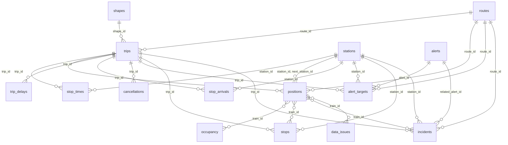

# OCEMT train data: Catalonia, 2–6 November 2026

Generated on 2026-11-16. Every file in this folder is produced by the data build. Do not edit them by hand: if something is wrong, report it and the files are regenerated.

## What this is, in 5 lines

1. Five weekdays (2026-11-02 to 2026-11-06) of real train activity in Catalonia, minute by minute, recorded live from the open feeds of RENFE (Rodalies, regional, long and medium distance) and FGC.
2. 978,960 train positions, plus delays, arrivals at stations, cancellations, alerts, FGC occupancy, and the timetables and track geometry they refer to.
3. Cleaned: impossible GPS jumps are fixed and flagged, IDs are consistent between files, and every column is documented in `schema.csv`.
4. Good for: a live-style map, history and replay, delay and incident analysis, and later the Redis cache demo.
5. Everything is plain CSV (most files gzipped), 21 data files, 37 MB in total, loadable into PostGIS with one command.

## Quick start

You need Docker (Docker Desktop on Windows, with WSL integration if you use WSL). From the repository root:

```bash
bash data/load/load.sh          # Linux, macOS, WSL
```

```powershell
powershell -ExecutionPolicy Bypass -File data\load\load.ps1   # Windows: use this one
```

On Windows, use `load.ps1` (or `load.sh` inside WSL). `load.sh` also copes with Git Bash. Neither `load.ps1` nor the Git Bash path has been tested on Windows yet: if one fails, use `load.sh` inside WSL and report the error.

This starts a container `ocemt-pg` from `postgis/postgis:18-3.7` with `data/` mounted read-only at `/data`, creates schema `import` with **one table per file** (`import.stations`, `import.positions`, …, typed, no keys or indexes), loads every CSV file and checks each table's row count against `manifest.csv`. `catalonia.geojson` is not loaded: it is the boundary as GeoJSON, for maps. It takes a few minutes.

Afterwards:

```bash
docker exec -it ocemt-pg psql -U postgres          # SQL prompt; try: SELECT count(*) FROM import.positions;
```

The server is also published on `localhost:5432` (user `postgres`, password `ocemt`) for GUI tools; set `OCEMT_PG_PORT` to use another port. The port is bound to 127.0.0.1 only, so other machines on your network cannot reach it; the fixed password is for this local throwaway database only. `docker rm -fv ocemt-pg` throws it all away, data volume included. Running the script again reloads the `import` schema.

To load into a PostgreSQL server you already run (installed locally or hosted), set `PGHOST` (and `PGPORT`, `PGUSER`, `PGDATABASE`, `PGPASSWORD` as needed) before running the script. It then runs `load/load_client.sql` with your own `psql`: the files are read on your machine with psql's `\copy` and decompressed by `gzip`, so no superuser is needed, but the server needs PostGIS (or the right to create it) and `psql` and `gzip` must be on your PATH. On Windows, `load.ps1` uses the `gzip.exe` that comes with Git for Windows when gzip is not on PATH.

## The data in one picture

Arrows follow the ID columns (`links_to` in `schema.csv`). `||--o{` means the ID is the key of the left table; `}o--o{` means it only matches rows there (for example `train_id` appears once per minute in `positions`).



| File | Rows | Size | What it is |
|---|---:|---:|---|
| `network/stations.csv.gz` | 412 | 12 KB | Stations used by any kept trip or inside the boundary, RENFE and FGC. |
| `network/routes.csv` | 219 | 18 KB | Lines (routes) of the kept trips. |
| `network/trips.csv.gz` | 19,667 | 144 KB | Timetabled runs with a stop in the boundary, service dates 2026-11-02 to 2026-11-06. |
| `network/stop_times.csv.gz` | 231,602 | 1.8 MB | Timetabled stops of every trip, times in UTC. |
| `network/shapes.csv.gz` | 75 | 219 KB | Route shapes from the timetables, clipped to the boundary. |
| `network/tracks.csv.gz` | 9,774 | 642 KB | Railway track geometry from OpenStreetMap (ODbL). |
| `realtime/positions/<day>.csv.gz (5 files)` | 978,960 | 24.9 MB | One row per train per minute, cleaned. One file per Madrid day. |
| `realtime/trip_delays.csv.gz` | 1,197,132 | 4.0 MB | Delay of each trip per minute while the feeds report it. |
| `realtime/stop_arrivals.csv.gz` | 172,351 | 1.7 MB | Observed arrival at each timetabled stop. |
| `realtime/cancellations.csv` | 5,758 | 392 KB | Cancelled or partly cancelled trips. |
| `realtime/alerts.csv` | 494 | 91 KB | Service alerts published by RENFE and FGC. |
| `realtime/alert_targets.csv` | 2,123 | 113 KB | What each alert applies to, one row per target. |
| `realtime/occupancy.csv.gz` | 337,874 | 1.1 MB | FGC occupancy per car per minute. |
| `events/stops.csv.gz` | 55,787 | 862 KB | Every time a train stood still for 2 minutes or more. |
| `events/incidents.csv` | 648 | 155 KB | Interpreted events: unexpected stops, cancellations, alerts. |
| `events/data_issues.csv.gz` | 28,100 | 467 KB | Every position the cleaning changed or dropped, with the original values. |

Plus `schema.csv` (every column: type, unit, meaning, links, natural key, example), `manifest.csv` (rows, bytes and SHA-256 of each data file), `catalonia.geojson` (the boundary used: the official polygon and the 10 km buffer), `LICENSE-DATA.md` and `load/`.

## What you need to decide

The `import` tables are a landing zone. Designing the real tables is your job; nothing below is done for you.

- [ ] **Primary and foreign keys.** The natural keys are marked `natural_key = true` in `schema.csv` (for example `positions`: `time` + `train_id`; `stop_times`: `trip_id` + `stop_sequence`). All IDs are text with an operator prefix (`renfe:…`, `fgc:…`). Decide whether to keep them or add surrogate integer keys. There is no `trains` table: `train_id` only exists in `positions` and the event files, so decide whether you want one. A few links have known exceptions (for example 97.1% of long-distance positions have a timetabled trip); check them before adding a foreign key.
- [ ] **What to normalise or merge.** For example: one `positions` table for every operator (as delivered) or one per operator; whether `alerts` + `alert_targets` and `incidents` stay separate; whether `stations` of different operators that share an `interchange_id` become one place.
- [ ] **Geometry columns and SRID.** Points come from `lat`/`lon` (`ST_SetSRID(ST_MakePoint(lon, lat), 4326)`), lines from WKT (`ST_GeomFromText(geometry_wkt, 4326)`). Store in SRID 4326 (WGS84). For distances in metres in Catalonia use EPSG:25831 (`ST_Transform(geom, 25831)`) or `geography`.
- [ ] **Indexes.** Typical needs: time ranges (`positions.time`), one train over time (`train_id`, `time`), one trip (`trip_id`), and GiST on every geometry column for map queries.
- [ ] **Partitioning `positions` by day.** It has 978,960 rows, about 196,000 per day. At this size a B-tree on `time` is enough and partitioning brings little speed; do it only to learn it or if you plan to add many more days.
- [ ] **Replaying the 5 days for the Redis demo later.** The data is a complete minute-by-minute history, so the app can "replay" it: read `positions` minute by minute (optionally faster than real time) and push each train's latest state into Redis. Keep `time` easy to query in order.

## How to work with your AI assistant

Recommended workflow: give the assistant these three files first, ask for a design and review it together before any code, then generate SQL step by step and test each step against the `import` tables. Copy-paste prompts, in order:

```text
Read `data/AGENTS.md`, `data/schema.csv` and `data/README.md`. Propose a normalised PostgreSQL/PostGIS schema for these files, with keys, foreign keys, geometry columns and indexes. Explain each choice. Don't write code yet.
```

```text
Write the SQL that creates those tables and fills them from the `import` schema with `INSERT … SELECT`, building geometries with PostGIS.
```

```text
Write 10 test queries that check the result: row counts match `manifest.csv`, no orphan foreign keys, and sample spatial queries (trains within 2 km of Barcelona Sants at 08:00 on 2026-11-05).
```

```text
Write example queries the app will need: the last position of every train at time T, the trains inside a map viewport, the incidents on line R1 on a given day, the delay history of one trip.
```

Tips:
- Start with one day of positions (for example the Madrid day 2 November, the file `2026-11-02.csv.gz`: `WHERE time >= '2026-11-01T23:00Z' AND time < '2026-11-02T23:00Z'`; a bare `'2026-11-03'` is UTC midnight, one hour after the Madrid day ends) while you iterate; load the rest when the design is stable.
- Never edit the CSVs. If something looks wrong, report it; the files are regenerated.
- Ask the assistant to explain `EXPLAIN ANALYZE` output, so you see what your indexes do.
- Remember that times are UTC: "08:00 on 2026-11-05" in Barcelona is `2026-11-05T07:00Z`.

## Things that will surprise you

- **Times are UTC** (ISO 8601 with `Z`). Madrid is UTC+1 in November. Position files are Madrid days: `2026-11-02.csv.gz` covers `2026-11-01T23:00Z` up to `2026-11-02T23:00Z`. Service dates (`service_date`) are Madrid calendar dates.
- **Empty means unknown** or not applicable. No 0 or -1 placeholders.
- **`trip_id` is a run, not a timetable id:** `<operator>:<raw id>@<service date>`, because the operators reuse the same raw trip id on several days. `trips.source_trip_id` holds the raw id.
- **`train_id` differs by operator.** Rodalies: one running train (the trip). Long distance: the train number, so it recurs every day. FGC: one run of the timetable (`fgc:<record id>`), **not a physical unit**; the unit is `vehicle_id`. FGC's unit code (`ut`) cannot be the key: among the FGC rows that are fresh observations, it is empty on 4,661 and the same unit is at two places in the same minute 195 times. To follow one physical FGC unit, group by `vehicle_id`.
- **Regional trains appear in both RENFE feeds** (Rodalies and long distance). The long-distance copy is dropped (44,231 minute-rows of 75 trains over all of Spain). Separately, 582 rows where both feeds report the same place in the same minute are different trains at Barcelona-Estació de França: both are kept.
- **`position_fixed` rows were corrected.** Cleaning fixes impossible moves (station fallback, out-and-back spikes, frozen positions that then jump, unexplained jumps). Share of positions fixed: Rodalies 2.1%, long distance 14.5%, FGC 0.3%. The long-distance feed refreshes each train only every few minutes, so it freezes and catches up often. Every original value is in `events/data_issues.csv.gz` (28,100 rows).
- **Speed limits used for cleaning:** Rodalies 220 km/h, long distance 350, FGC 160. A move faster than that is allowed up to 350 km/h when it ends at a station, because the Rodalies feed snaps a train to its next station a little early. So 8,372 Rodalies rows in Catalonia show `speed_kmh` between 220 and 350: **they are left as published** (the train reached the station's coordinates early), not real speeds. A position held for 120 s or more away from a station and then left faster than 100 km/h is treated as frozen data.
- **`track_split`: a train that reappears farther away than 350 km/h allows starts a new track.** The jump is not smoothed: it is logged in `events/data_issues.csv.gz` as `track_split` (28 in Catalonia) and the first row of the new track has an empty `speed_kmh`. So consecutive rows of one `train_id` can still imply an impossible speed across a split; skip those pairs in speed checks. Some look like two trains reported under one number: long-distance `renfe:15043` reappears 123 km away, at Barcelona, on 2026-11-02 and again on 2026-11-03 (1,055 km/h).
- **`carried_forward` rows repeat the previous minute,** because the feed did not change or could not be fetched. FGC publishes new positions only about every 2 minutes, so 54% of FGC rows are carried forward. They are not stops.
- **`movement`:** `moving`; `stopped_station` (still for 2 minutes or more within 400 m of a station, 600 m for FGC; `station_id` says which); `stopped_line` (still between stations). Stops are listed in `events/stops.csv.gz` (55,787 rows).
- **Real stops are never smoothed away:** the build checks that 0 real line stops were lost by cleaning. Fixing can also create stops (a spike removed between two halves of one stop joins them: 277 such line stops over Spain); they are counted separately.
- **Incidents are interpretations,** with an `evidence` column. 21 unexpected stops, 514 cancellations, 113 alerts (89 RENFE, 24 FGC). Delays are data (`trip_delays`, `stop_arrivals`, `positions.delay_s`), not incidents.
- **Unexpected stops (21)** are line stops of 5 minutes or more inside the trip's timetabled window, minus: stale positions (the next station changed during the "stop": 17), hold points where 2 or more trains stop within 50 m (62), recurring stops (same train, same place, within 15 min of the same clock time on another day: 4) and long-distance stops without a delay over 60 s (4; long-distance vehicles have no timestamp, so a held position cannot be told from a stale one). A long-distance delay shows the train was already late, not that the stop caused it.
- **Not every alert is an incident.** `realtime/alerts.csv` keeps all 494 alerts. Only disruptions become `alert` incidents: every RENFE alert and the FGC alerts whose id starts with `fgc:INCIDENCE_` (113). The 381 FGC `fgc:OBSERVATIONS_*` alerts are timetable notes (connections with the Montserrat rack railway or a bus, cars reserved for school groups), so they are not incidents. Tell them apart by the `alert_id` prefix.
- **Cancellations** have an `evidence`: `feed_canceled` (334: the feed said so), `stops_skipped` (180: scope `partial`, the feed skipped at least one stop; no update skips all of them) and `not_reported` (5,244: timetabled in Catalonia but never seen in any feed, mostly whole services: R3 trips numbered 87xxx and the FGC Vallvidrera funicular, FV). `not_reported` is low confidence: those rows stay in `cancellations` but are **not** incidents. A trip listed as cancelled and also as running in the same minute (a cancelled original next to its replacement) counts as cancelled in that minute only if no position has that `trip_id` then; 1,292 such minutes of 12 trips had a position, and 2 trips that ran drop out of the cancellations. The long-distance feed marks most of its trips as cancelled: this is real (after the recent RENFE accident).
- **Cancellation incidents use the timetable:** `start`/`end` are the trip's timetabled times, so an `end` can fall after the 5-day window (latest 2026-11-06T23:03Z).
- **RENFE delays near midnight:** RENFE sometimes computes a delay against the wrong day. Delays beyond ±12 h are moved by one day (3,239 trip-minutes over all of Spain) and anything still beyond ±6 h is left empty (1,489). FGC delay is the predicted minus the timetabled time at the next stop; FGC never publishes early (negative) delays.
- **RENFE alerts before 2026-11-04T16:49Z are not live:** that feed was frozen on a weeks-old snapshot until then. Those alerts have `live = false` (8 of them).
- **Link rates:** 97.1% of long-distance positions have a trip in the timetable (the rest are `SPECIAL_*` or similar trips the timetable lacks). FGC: 99.8%. The long-distance positions feed's header clock runs about 1 hour behind and its vehicles have no timestamp.
- **FGC is the only source with occupancy** (`realtime/occupancy.csv.gz`, 337,874 rows, per car).
- **FGC polling:** its GTFS-RT feeds (trip updates, alerts, vehicle positions) were recorded every 5 minutes and its own positions every minute. 103 FGC trip-update files started with a server warning in front of the data; it was stripped.
- **Boundary:** official Catalonia polygon (simplified to 10 m in `catalonia.geojson`) plus a 10 km buffer. Stations and positions inside the buffer are kept, so a few just outside Catalonia appear.
- **Stations without municipality or province:** of the 308 RENFE stations, 108 have no municipality and 117 no province, because RENFE's station list (`estaciones.csv`) does not include them; many are in Catalonia (Sitges, Gavà, El Prat…). FGC stations never have them. Grouping by municipality loses those stations: use a spatial join instead.
- **SQL names:** `end` (in `stops` and `incidents`) is a reserved word: write `"end"`.

## Where things come from and credits

Full description of the sources, the cleaning rules and the measurements: the wiki's [Data page](https://github.com/parque27/SGBDTrainManager/wiki/Data).

- RENFE data: *Origen de los datos: Renfe Operadora*, CC BY 4.0 (realtime GTFS-RT feeds and GTFS timetables, recorded 2026-11-01T23:00Z to 2026-11-06T23:00Z).
- FGC data: Ferrocarrils de la Generalitat de Catalunya, CC BY 4.0.
- Track geometry and the Catalonia boundary: © OpenStreetMap contributors, ODbL 1.0.

The data has been cleaned and transformed; the sources do not endorse this project and do not guarantee accuracy or continuity. Details in `LICENSE-DATA.md`.
